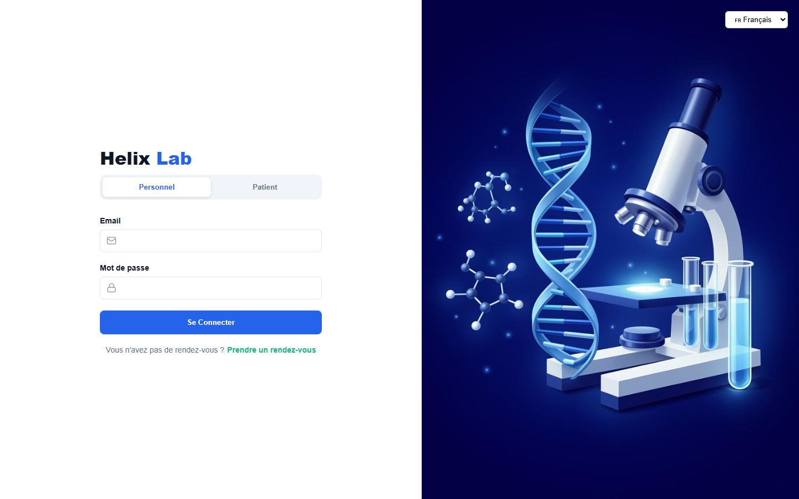
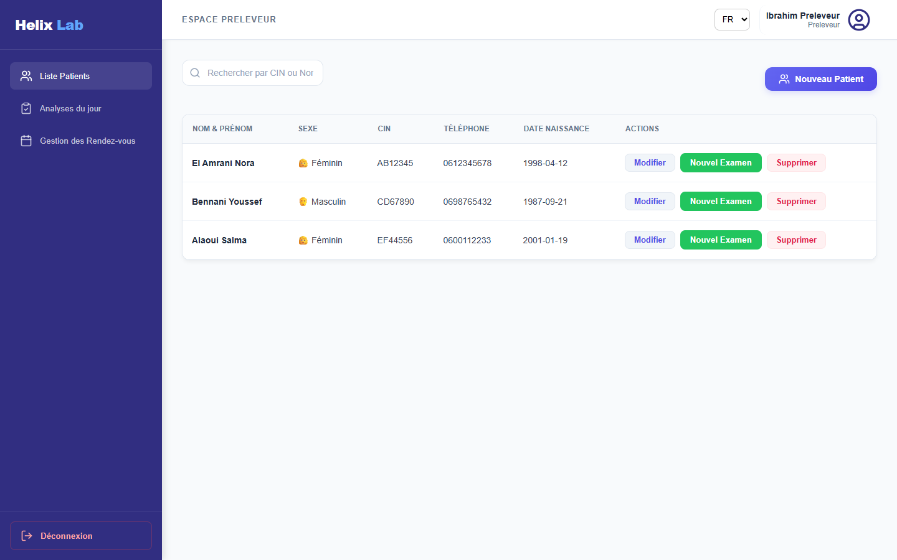

# 🧬 Helix Lab — Laboratory Management System

<p align="center">
  A Full Stack Web Application for Managing Medical Laboratory Operations.
</p>

<p align="center">
  
  
  
</p>

---

## 📌 About The Project

**Helix Lab** is a full stack web application designed to simplify and optimize the management of medical analysis laboratories.

The platform manages laboratory workflows, from appointment scheduling and patient registration to examination tracking and medical result delivery.

## ✨ Main Features

- Patient management
- Appointment management
- Medical examination management
- Analysis and result tracking
- Role-based user management
- Laboratory dashboard
- Medical results management

## 🛠️ Tech Stack

### Frontend
- React.js
- Tailwind CSS
- Shadcn/ui

### Backend
- PHP
- Laravel
- REST API

### Database
- MySQL

### Tools
- Git & GitHub
- PlantUML
- Visual Studio Code

## 📂 Project Structure

```text
Helix-Lab/
├── Back-end/
│   └── Laravel Application
├── frontend/
│   └── React Application
└── README.md
```

## ⚙️ Installation & Setup

### 1. Clone the repository

```bash
git clone https://github.com/yassineboulaagine-png/yassine.git
cd yassine
```

### 2. Backend Setup

```bash
cd Back-end
composer install
```

Create your environment file:

```bash
cp .env.example .env
```

Generate the application key:

```bash
php artisan key:generate
```

Configure your local MySQL database credentials in `.env`.

Run migrations:

```bash
php artisan migrate
```

Start the Laravel server:

```bash
php artisan serve
```

### 3. Frontend Setup

Open a new terminal:

```bash
cd frontend
npm install
npm run dev
```


## 🔌 API Endpoints

Helix Lab provides a RESTful API built with Laravel to manage laboratory operations.

### Authentication

| Method | Endpoint | Description |
|---|---|---|
| POST | `/api/login` | Authenticate users |
| POST | `/api/logout` | Log out the authenticated user |
| GET | `/api/me` | Retrieve authenticated user |

### Patients

| Method | Endpoint | Description |
|---|---|---|
| GET | `/api/patients` | Retrieve all patients |
| POST | `/api/patients` | Register a new patient |
| GET | `/api/patients/{patient}` | Retrieve patient details |
| PUT/PATCH | `/api/patients/{patient}` | Update patient information |
| DELETE | `/api/patients/{patient}` | Delete a patient |
| GET | `/api/patients/count/{id}` | Retrieve patient count |
| GET | `/api/patients/export-xml/{id}` | Export patients as XML |

### Medical Analyses

| Method | Endpoint | Description |
|---|---|---|
| GET | `/api/analyses` | Retrieve analyses |
| POST | `/api/analyses` | Create an analysis |
| GET | `/api/analyses/{id}` | Retrieve an analysis |
| PUT | `/api/analyses/{id}` | Update an analysis |
| DELETE | `/api/analyses/{id}` | Delete an analysis |
| GET | `/api/type-analyses` | Retrieve analysis types |

### Examinations & Results

| Method | Endpoint | Description |
|---|---|---|
| GET | `/api/examens` | Retrieve examinations |
| POST | `/api/examens` | Create an examination |
| PUT | `/api/examens/{id}` | Update an examination |
| DELETE | `/api/examens/{id}` | Delete an examination |
| PATCH | `/api/examens/{id}/annuler` | Cancel an examination |
| PATCH | `/api/examens/{id}/valider` | Validate an examination |
| PATCH | `/api/examens/{id}/approve` | Approve an examination |
| PUT | `/api/examens/{id}/reject` | Reject an examination |
| GET | `/api/examens/{id}/pdf` | Generate examination PDF |
| GET | `/api/examens/my-results` | Retrieve patient results |
| GET | `/api/examens/results/{id}` | Retrieve examination results |
| POST | `/api/examens/{id}/resultats` | Store examination results |

### Appointments

| Method | Endpoint | Description |
|---|---|---|
| GET | `/api/rendezvous` | Retrieve appointments |
| POST | `/api/rendezvous/store` | Create an appointment |
| POST | `/api/rendezvous/send-code` | Send appointment verification code |
| PUT | `/api/rendezvous/{id}/statut` | Update appointment status |
| POST | `/api/rendez-vous/{id}/passer-au-labo` | Transfer appointment to laboratory |

### Dashboard & Statistics

| Method | Endpoint | Description |
|---|---|---|
| GET | `/api/admin/stats` | Retrieve administrator statistics |
| GET | `/api/biologiste/stats` | Retrieve biologist statistics |
| GET | `/api/stats/monthly-analyses` | Retrieve monthly analysis statistics |


## 📸 Screenshots

### Login Page


### Admin Dashboard


### Biologist Dashboard


### Appointment Management


### Sample Collector Dashboard



## 🔐 Security

- Environment variables are excluded from version control.
- Never commit passwords, API keys, or database credentials.
- Configure your own local environment before running the application.

## 👨‍💻 Author

**Yassine Boulaagine**

Junior Full Stack Developer

- GitHub: [@yassineboulaagine-png](https://github.com/yassineboulaagine-png)

---

<p align="center">
  Built with ❤️ by Yassine Boulaagine
</p>
