# Rapport de Projet de Fin d’Études / Projet de Fin d’Année

# 1. Page de garde

**Royaume du Maroc**  
**[Nom de l’établissement / Institut / Université]**  
**[Département Informatique / Développement Digital / Génie Logiciel]**

Présenté par :

**[Nom et prénom étudiant 1]**

**[Nom et prénom étudiant 2]**

Sous le thème :

# Conception et réalisation d’une application web de gestion de laboratoire d’analyses médicales

## Cas du système **Helix Lab**

Encadrant pédagogique :  
**[Nom de l’encadrant pédagogique]**

Encadrant professionnel :  
**[Nom de l’encadrant professionnel]**

Organisme d’accueil :  
**[Nom de l’entreprise / laboratoire / établissement]**

Année académique :  
**2025-2026**

---

# 2. Dédicace

Je dédie ce travail à mes parents, pour leur soutien constant, leur patience et leurs encouragements tout au long de mon parcours académique. Leur confiance m’a permis d’avancer avec détermination et de surmonter les difficultés rencontrées durant la réalisation de ce projet.

Je dédie également ce rapport à ma famille, à mes proches et à toutes les personnes qui m’ont accompagné moralement et intellectuellement. Leur présence a été une source de motivation précieuse.

Enfin, je dédie ce travail à mes enseignants et formateurs, qui ont contribué à développer mes compétences techniques, mon esprit d’analyse et ma rigueur professionnelle.

---

# 3. Remerciements

Avant de présenter ce travail, je tiens à exprimer ma profonde gratitude à toutes les personnes qui ont contribué, directement ou indirectement, à la réussite de ce projet.

Je remercie tout d’abord mon encadrant pédagogique, **[Nom de l’encadrant]**, pour son suivi, ses conseils méthodologiques et ses remarques constructives qui m’ont permis d’améliorer la qualité technique et documentaire du projet.

Je remercie également mon encadrant professionnel, **[Nom de l’encadrant professionnel]**, pour son accompagnement, sa disponibilité et ses orientations concernant les besoins réels d’un système de gestion de laboratoire médical.

Mes remerciements s’adressent aussi à l’ensemble du corps professoral de **[Nom de l’établissement]**, pour la formation reçue durant ces années d’études, notamment dans les domaines du développement web, des bases de données, de la modélisation UML et de l’ingénierie logicielle.

Enfin, je remercie toutes les personnes ayant participé à la validation fonctionnelle du projet, ainsi que mes collègues pour leurs échanges et leurs encouragements.

---

# 4. Résumé

Le présent rapport décrit la conception et la réalisation de **Helix Lab**, une application web destinée à la gestion d’un laboratoire d’analyses médicales. Le projet répond à un besoin de digitalisation du processus de traitement des patients, des rendez-vous, des examens biologiques et des résultats médicaux.

Le système développé permet à plusieurs profils d’utilisateurs d’interagir avec la plateforme selon leurs responsabilités. L’administrateur dispose d’un tableau de bord de suivi, gère les patients, les analyses et le personnel. Le préleveur prend en charge l’enregistrement des patients, la création des examens et la validation des prélèvements. Le biologiste consulte les examens à traiter, saisit les résultats, effectue la validation finale et accède à l’historique. Le patient peut demander un rendez-vous, s’authentifier à l’aide de sa référence d’examen et consulter ses résultats.

Sur le plan technique, l’application repose sur une architecture client-serveur. La partie frontend est développée avec **React 18**, **Vite**, **React Router**, **Axios**, **i18next**, **Recharts**, **Tailwind CSS** et des composants UI inspirés de **shadcn/Radix UI**. La partie backend est développée avec **Laravel 12**, **PHP 8.2**, **Laravel Sanctum**, **Eloquent ORM**, les migrations Laravel, les services de mail et la génération PDF via **barryvdh/laravel-dompdf**. La communication entre les deux parties se fait à travers une API REST.

Le projet a permis de mettre en œuvre une solution complète, sécurisée et évolutive, adaptée au contexte d’un laboratoire moderne. Il améliore la traçabilité des examens, réduit les opérations manuelles, facilite l’accès aux résultats et centralise les informations médicales importantes.

**Mots-clés :** laboratoire médical, React, Laravel, API REST, Sanctum, gestion des patients, analyses médicales, résultats, rendez-vous, PDF.

---

# 5. Abstract

This report presents the design and implementation of **Helix Lab**, a web application dedicated to the management of a medical analysis laboratory. The project aims to digitize the workflow related to patients, appointments, laboratory exams and medical results.

The system provides several user spaces according to the responsibilities of each profile. The administrator manages the general dashboard, patients, analysis types and staff members. The sampling agent registers patients, creates exams and validates sampling operations. The biologist manages exams awaiting result entry, validates medical results and consults the history. The patient can request an appointment, access results using an exam reference and download the medical report.

Technically, the application follows a client-server architecture. The frontend is based on **React 18**, **Vite**, **React Router**, **Axios**, **i18next**, **Recharts**, **Tailwind CSS** and UI components inspired by **shadcn/Radix UI**. The backend is built with **Laravel 12**, **PHP 8.2**, **Laravel Sanctum**, **Eloquent ORM**, database migrations, mail services and PDF generation using **barryvdh/laravel-dompdf**. Communication is ensured through REST APIs.

The final solution improves traceability, reduces manual processing, secures access to sensitive data and provides a professional digital environment for laboratory staff and patients.

**Keywords:** medical laboratory, React, Laravel, REST API, Sanctum, patient management, medical analyses, results, appointments, PDF.

---

# 6. Table des matières

1. Dédicace  
2. Remerciements  
3. Résumé  
4. Abstract  
5. Liste des figures  
6. Liste des tableaux  
7. Introduction générale  
8. Chapitre 1 : Étude théorique et analyse des besoins  
9. Chapitre 2 : Technologies et outils utilisés  
10. Chapitre 3 : Analyse et conception  
11. Chapitre 4 : Réalisation et implémentation
12. Chapitre 5 : Tests et validation
13. Conclusion générale
14. Bibliographie
15. Annexes

---

# 7. Table des figures

- Figure 1 : Logo et identité visuelle de Helix Lab.
- Figure 2 : Architecture générale de l’application.
- Figure 3 : Diagramme de cas d’utilisation global.
- Figure 4 : Diagramme de classes principal.                 16
- Figure 5 : Diagramme de séquence d’authentification du personnel.
- Figure 6 : Diagramme de séquence de création d’un examen.
- Figure 7 : Diagramme de séquence de saisie et validation des résultats.
- Figure 8 : Diagramme d’activité du processus de rendez-vous.
- Figure 9 : Modèle relationnel de la base de données.
- Figure 10 : Interface de connexion.
- Figure 11 : Interface de prise de rendez-vous.
- Figure 12 : Tableau de bord administrateur.
- Figure 13 : Gestion des patients.
- Figure 14 : Gestion des analyses.
- Figure 15 : Gestion du personnel.
- Figure 16 : Espace préleveur.
- Figure 17 : Gestion des rendez-vous.
- Figure 18 : Espace biologiste.
- Figure 19 : Modal de saisie des résultats.
- Figure 20 : Interface de consultation des résultats patient.
- Figure 21 : Rapport PDF des résultats.

---

# Liste des tableaux

- Tableau 1 : Identification des acteurs du système.
- Tableau 2 : Principales routes API de l’application.
- Tableau 3 : Scénarios de test fonctionnels.

---

# Introduction générale

## Contexte général

Le secteur médical connaît une transformation numérique importante. Les établissements de santé, les cabinets médicaux et les laboratoires d’analyses biologiques sont progressivement amenés à remplacer les procédures manuelles par des solutions informatisées capables d’assurer la rapidité, la fiabilité et la traçabilité des opérations.

Dans un laboratoire d’analyses médicales, plusieurs opérations sont réalisées quotidiennement : l’accueil des patients, l’enregistrement des informations personnelles, la planification des rendez-vous, la création des examens, la validation des prélèvements, la saisie des résultats biologiques, la validation médicale et la communication des résultats aux patients. Lorsque ces opérations sont gérées manuellement ou à travers des outils séparés, elles peuvent entraîner des erreurs, des retards et une perte de visibilité sur l’état réel des dossiers.

Le projet **Helix Lab** s’inscrit dans ce contexte. Il vise à proposer une application web centralisée permettant de gérer le cycle complet d’un examen biologique, depuis la demande de rendez-vous jusqu’à la consultation du résultat final.

## Problématique

La problématique principale peut être formulée ainsi :

**Comment concevoir et réaliser une application web sécurisée, ergonomique et évolutive permettant de centraliser la gestion des patients, des rendez-vous, des examens, des résultats et des utilisateurs d’un laboratoire d’analyses médicales ?**

Cette problématique soulève plusieurs questions :

- Comment organiser les responsabilités entre l’administrateur, le préleveur, le biologiste et le patient ?
- Comment assurer une authentification sécurisée du personnel ?
- Comment suivre le statut d’un examen depuis sa création jusqu’à sa validation finale ?
- Comment faciliter l’accès du patient à ses résultats sans compromettre la confidentialité des données ?
- Comment générer un rapport de résultats exploitable et professionnel ?

## Motivation du projet

La motivation du projet réside dans la volonté de construire une solution proche d’un besoin réel. Le laboratoire médical est un environnement où la donnée doit être fiable, accessible aux bonnes personnes et protégée contre les accès non autorisés. Le développement de Helix Lab constitue donc un cas pratique complet combinant développement frontend, développement backend, sécurité, modélisation de base de données, API REST et expérience utilisateur.

Ce projet permet également de mettre en pratique des technologies modernes utilisées dans le monde professionnel, notamment React pour l’interface utilisateur et Laravel pour la partie serveur.

## Objectifs généraux

Les objectifs principaux du projet sont :

- digitaliser la gestion des patients et des examens ;
- offrir un espace de travail adapté à chaque rôle ;
- centraliser les données dans une base cohérente ;
- assurer une authentification sécurisée du personnel ;
- permettre la consultation des résultats par le patient ;
- générer des rapports PDF ;
- améliorer la traçabilité et le suivi des dossiers ;
- proposer une interface moderne, claire et responsive.

## Importance du projet

L’importance de Helix Lab se manifeste à plusieurs niveaux. Sur le plan organisationnel, l’application réduit le recours aux supports papier et facilite la coordination entre les différents intervenants du laboratoire. Sur le plan technique, elle met en place une architecture moderne, modulaire et maintenable. Sur le plan humain, elle améliore l’expérience du personnel et du patient en rendant les informations plus accessibles et mieux structurées.

---

# CHAPITRE 1 — Étude théorique et analyse des besoins

## 1.1 Présentation du projet

Helix Lab est une application web de gestion de laboratoire d’analyses médicales. Elle permet de gérer les patients, les rendez-vous, les examens biologiques, les types d’analyses, les résultats, le personnel et les statistiques d’activité.

Le système est organisé autour de plusieurs espaces :

- un espace administrateur ;
- un espace préleveur ;
- un espace biologiste ;
- un espace patient ;
- une interface publique de prise de rendez-vous.

Chaque espace répond à des besoins fonctionnels spécifiques. Cette séparation améliore la clarté de l’interface, renforce la sécurité et facilite l’utilisation quotidienne de la plateforme.

## 1.2 Problématique détaillée

Dans un laboratoire classique, la gestion des dossiers médicaux peut devenir complexe lorsque le nombre de patients augmente. Les informations peuvent être dispersées entre plusieurs supports : formulaires papier, fichiers bureautiques, appels téléphoniques, e-mails et documents imprimés. Cette dispersion peut provoquer :

- des doublons dans les dossiers patients ;
- des erreurs dans les références d’examens ;
- des retards dans la validation des résultats ;
- un manque de visibilité sur l’état d’un examen ;
- une difficulté à retrouver l’historique ;
- une communication moins fluide avec les patients.

Le projet vise donc à répondre à ces limites par une solution centralisée, structurée et sécurisée.

## 1.3 Objectifs spécifiques

Les objectifs spécifiques sont les suivants :

- permettre à l’administrateur de suivre l’activité du laboratoire ;
- gérer les utilisateurs du personnel, notamment les biologistes et les préleveurs ;
- gérer les patients et leurs informations personnelles ;
- gérer les types d’analyses et les analyses élémentaires ;
- enregistrer un examen avec une référence unique ;
- associer automatiquement les lignes d’analyse à un examen ;
- permettre au biologiste de saisir les valeurs et commentaires ;
- permettre une validation finale des résultats ;
- permettre au patient d’accéder à ses résultats ;
- générer un rapport PDF ;
- envoyer des e-mails liés aux rendez-vous et aux résultats.

## 1.4 Étude des besoins fonctionnels

### 1.4.1 Besoins de l’administrateur

L’administrateur est responsable du pilotage global du système. Il doit pouvoir :

- accéder à un tableau de bord présentant les statistiques principales ;
- consulter le nombre total de patients ;
- suivre les analyses validées et les analyses en cours ;
- visualiser des graphiques d’évolution ;
- gérer les patients ;
- gérer les analyses et les types d’analyses ;
- gérer le personnel ;
- créer des comptes de biologistes et de préleveurs ;
- modifier son profil et son mot de passe.

### 1.4.2 Besoins du préleveur

Le préleveur intervient dans la phase d’accueil et de prélèvement. Il doit pouvoir :

- consulter la liste des patients ;
- rechercher un patient par nom ou CIN ;
- créer un nouveau patient ;
- modifier ou supprimer un patient ;
- créer un nouvel examen pour un patient ;
- générer une référence d’examen ;
- consulter les analyses du jour ;
- valider ou annuler un examen ;
- gérer les rendez-vous ;
- transformer un rendez-vous accepté en dossier de laboratoire.

### 1.4.3 Besoins du biologiste

Le biologiste intervient dans la phase de traitement et de validation des résultats. Il doit pouvoir :

- consulter les examens prêts à être traités ;
- saisir les valeurs de résultats pour chaque ligne d’analyse ;
- ajouter un commentaire médical ;
- visualiser les normes minimales et maximales ;
- détecter les valeurs anormales ;
- envoyer les résultats en validation ;
- approuver définitivement un examen ;
- rejeter un examen pour modification ;
- consulter l’historique des examens terminés ;
- accéder à son profil et à ses paramètres.

### 1.4.4 Besoins du patient

Le patient doit pouvoir :

- prendre un rendez-vous en ligne ;
- recevoir un code de vérification par e-mail ;
- confirmer sa demande de rendez-vous ;
- accéder à ses résultats à partir d’une référence et d’un numéro de téléphone ;
- télécharger un rapport PDF lorsque le résultat est disponible.

## 1.5 Besoins non fonctionnels

Les besoins non fonctionnels sont essentiels pour garantir la qualité du système :

- **Sécurité :** protection des routes sensibles par authentification, utilisation de tokens Sanctum, validation des données.
- **Ergonomie :** interfaces simples, tableaux lisibles, boutons clairs, notifications utilisateur.
- **Performance :** communication API directe, chargement ciblé des données, recherche côté API.
- **Maintenabilité :** séparation frontend/backend, contrôleurs spécialisés, modèles Eloquent, composants UI réutilisables.
- **Traçabilité :** références uniques, statuts d’examens, relations entre utilisateurs, patients et examens.
- **Évolutivité :** possibilité d’ajouter de nouveaux rôles, de nouveaux types d’analyses ou de nouveaux canaux de notification.
- **Accessibilité linguistique :** présence d’un système d’internationalisation avec français et arabe.
- **Fiabilité :** migrations de base de données, validation Laravel, gestion des erreurs côté frontend.

## 1.6 Contraintes techniques

Le projet repose sur les contraintes suivantes :

- utilisation d’une architecture web client-serveur ;
- communication entre React et Laravel via API REST ;
- authentification du personnel via Laravel Sanctum ;
- stockage du token côté client dans `localStorage` ;
- base de données relationnelle pilotée par les migrations Laravel ;
- génération des rapports PDF côté serveur ;
- utilisation d’un environnement local de développement de type Laragon avec domaine `projet_pff.test`.

## 1.7 Identification des acteurs

| Acteur | Rôle dans le système | Principales actions |
|---|---|---|
| Administrateur | Supervise la plateforme | Statistiques, gestion patients, analyses, staff |
| Préleveur | Gère l’accueil et les prélèvements | Patients, examens, rendez-vous, validation prélèvement |
| Biologiste | Gère la saisie et validation médicale | Résultats, approbation, historique |
| Patient | Consulte ses services | Rendez-vous, accès résultats, PDF |

## 1.8 Avantages du système

Helix Lab apporte plusieurs avantages :

- centralisation des données ;
- réduction des erreurs de saisie ;
- meilleure coordination entre les rôles ;
- amélioration de la rapidité de traitement ;
- génération automatique de références ;
- accès simplifié aux résultats ;
- suivi statistique de l’activité ;
- interface moderne adaptée aux usages professionnels.

---

# CHAPITRE 2 — Technologies et outils utilisés

## 2.1 Architecture technologique globale

Le projet repose sur une architecture composée de deux parties principales :

- **Frontend :** application React développée avec Vite, responsable de l’interface utilisateur.
- **Backend :** API Laravel responsable de la logique métier, de l’authentification, de la base de données, des e-mails et des PDF.

Cette séparation permet de rendre l’application plus modulaire. Le frontend consomme les données via des appels HTTP, tandis que le backend centralise les règles métier.

## 2.2 Technologies frontend

### React 18

React est une bibliothèque JavaScript utilisée pour créer des interfaces utilisateur dynamiques. Dans Helix Lab, React permet de construire les pages principales : connexion, tableau de bord administrateur, espace préleveur, espace biologiste, prise de rendez-vous et consultation des résultats.

React a été choisi pour sa modularité, sa rapidité de rendu et sa capacité à gérer des interfaces riches à travers des composants réutilisables.

### Vite

Vite est un outil moderne de développement frontend. Il permet de lancer rapidement le serveur de développement, de compiler l’application et de produire une version optimisée pour la production.

Dans le projet, Vite est utilisé à travers les scripts `dev`, `build`, `preview` et `test` définis dans `package.json`.

### React Router DOM

React Router DOM permet de gérer la navigation entre les pages. Dans le fichier `App.jsx`, les routes sont définies pour les espaces suivants :

- `/login`
- `/dashboard/admin`
- `/dashboard/biologiste`
- `/dashboard/preleveur`
- `/prendre-rendez-vous`
- `/mes-resultats`
- `/patient/results`
- pages de profil et paramètres.

Le projet utilise également des composants de protection de routes selon le rôle : `AdminRoute`, `BiologisteRoute` et `PreleveurRoute`.

### Axios et Fetch

Axios est utilisé pour effectuer des requêtes HTTP vers l’API Laravel. Un fichier `api.js` centralise aussi certaines fonctions, notamment `apiLogin` et `apiFetch`.

Les requêtes protégées ajoutent l’en-tête :

```http
Authorization: Bearer <token>
```

### Context API

Le fichier `AuthContext.jsx` gère l’état d’authentification côté frontend. Il lit l’utilisateur et le token depuis `localStorage`, expose les données au reste de l’application et permet la déconnexion.

### Tailwind CSS

Tailwind CSS est utilisé pour fournir une base de design utility-first. Le fichier `tailwind.config.ts` définit notamment la police Inter, les couleurs liées au thème et les variables compatibles avec les composants UI.

### shadcn/Radix UI

Le projet contient un dossier `components/ui` regroupant plusieurs composants inspirés de shadcn UI et Radix UI : boutons, dialogues, menus, tabs, tableaux, formulaires, popovers, tooltips, badges, etc. Ces composants améliorent la cohérence visuelle et accélèrent la réalisation de l’interface.

### Lucide React

Lucide React fournit des icônes modernes utilisées dans les menus, boutons et tableaux de bord : utilisateurs, microscope, paramètres, déconnexion, calendrier, validation, etc.

### Recharts

Recharts est utilisé dans le tableau de bord administrateur pour afficher des graphiques, notamment l’évolution des analyses validées et la répartition des statuts.

### i18next et react-i18next

Le projet intègre l’internationalisation via i18next. Certaines interfaces proposent un changement de langue français/arabe et adaptent le sens d’affichage selon la langue choisie.

### Sonner, React Hot Toast et React Toastify

Ces bibliothèques servent à afficher des notifications utilisateur : succès de connexion, enregistrement d’un patient, erreur de validation, confirmation de rendez-vous, etc.

## 2.3 Technologies backend

### Laravel 12

Laravel est le framework PHP utilisé pour développer le backend. Il fournit une architecture MVC, un système de routage, des contrôleurs, des modèles Eloquent, des migrations, la validation des requêtes et les services de sécurité.

Dans Helix Lab, Laravel expose une API REST consommée par React.

### PHP 8.2

PHP est le langage côté serveur utilisé par Laravel. La version 8.2 apporte de bonnes performances et une syntaxe moderne.

### Laravel Sanctum

Laravel Sanctum est utilisé pour l’authentification par tokens. Lors de la connexion, le contrôleur `AuthController` vérifie l’e-mail et le mot de passe, puis crée un token personnel avec :

```php
$user->createToken('limstoken')->plainTextToken;
```

Ce token est renvoyé au frontend et utilisé pour accéder aux routes protégées.

### Eloquent ORM

Eloquent est l’ORM de Laravel. Il permet de manipuler les tables sous forme de modèles : `User`, `Patient`, `Examen`, `Analyse`, `TypeAnalyse`, `RendezVous`, `LigneExamen`, `Resultat`, etc.

Les relations Eloquent facilitent la récupération des données liées, par exemple un examen avec son patient et ses lignes d’analyses.

### Migrations Laravel

Les migrations définissent la structure de la base de données. Elles permettent de créer les tables, les clés étrangères, les champs obligatoires et les statuts.

### Mail Laravel

Le projet utilise des classes Mailables, notamment :

- `VerificationCodeMail`
- `StatutRendezVousMail`
- `ResultatExamenMail`

Ces classes permettent d’envoyer des codes de vérification, des notifications de rendez-vous et des résultats.

### Cache Laravel

Le cache est utilisé pour stocker temporairement le code de vérification envoyé au patient lors d’une demande de rendez-vous. Le code est conservé pendant une durée limitée, ce qui améliore la sécurité du processus.

### DomPDF

La bibliothèque `barryvdh/laravel-dompdf` permet de générer un rapport PDF des résultats d’examen à partir d’une vue Blade.

## 2.4 Base de données

Le fichier `.env.example` indique une configuration par défaut en SQLite, tandis que `config/database.php` prévoit également la compatibilité avec MySQL, MariaDB, PostgreSQL et SQL Server. Dans un environnement Laragon, la base peut être configurée avec MySQL/MariaDB selon les besoins du déploiement local.

## 2.5 Outils de développement

- **npm :** gestion des dépendances frontend.
- **Composer :** gestion des dépendances PHP.
- **ESLint :** analyse statique du code frontend.
- **Vitest :** tests unitaires côté frontend.
- **Testing Library :** tests de composants React.
- **Playwright :** tests end-to-end et capture d’interfaces.
- **PHPUnit :** tests backend Laravel.
- **Laravel Pint :** formatage du code PHP.
- **Laravel Pail :** suivi des logs en développement.
- **Git :** suivi des versions.

---

# CHAPITRE 3 — Analyse et conception

## 3.1 Architecture globale

L’application suit une architecture client-serveur :

1. L’utilisateur interagit avec l’interface React.
2. React envoie des requêtes HTTP vers l’API Laravel.
3. Laravel valide les données et applique la logique métier.
4. Les modèles Eloquent communiquent avec la base de données.
5. Laravel renvoie une réponse JSON au frontend.
6. React met à jour l’interface selon la réponse.

Cette architecture permet de séparer clairement la présentation, la logique métier et la persistance des données.

## 3.2 Workflow général du système

Le cycle principal d’un examen se déroule comme suit :

1. Le patient est enregistré par le préleveur ou demande un rendez-vous en ligne.
2. Un examen est créé et associé à un patient.
3. Une référence unique est générée.
4. Les lignes d’analyses sont créées selon le type d’analyse choisi.
5. Le préleveur valide ou annule le prélèvement.
6. Le biologiste saisit les résultats.
7. L’examen passe en attente de validation.
8. Le biologiste approuve définitivement ou rejette pour modification.
9. Le patient accède à ses résultats.
10. Un rapport PDF peut être généré.

## 3.3 Concepts UML utilisés

UML, ou Unified Modeling Language, est un langage de modélisation utilisé pour représenter les besoins, la structure et le comportement d’un système logiciel. Dans ce projet, les diagrammes UML permettent de clarifier les interactions entre les acteurs, les classes, les objets et les processus métier.

## 3.4 Diagramme de cas d’utilisation

### Acteurs du diagramme

- Administrateur
- Préleveur
- Biologiste
- Patient
- Système de messagerie

### Cas d’utilisation de l’administrateur

- Se connecter
- Consulter le tableau de bord
- Gérer les patients
- Gérer les analyses
- Gérer le personnel
- Modifier son profil
- Changer son mot de passe

### Cas d’utilisation du préleveur

- Se connecter
- Rechercher un patient
- Ajouter un patient
- Modifier un patient
- Supprimer un patient
- Créer un examen
- Valider un prélèvement
- Annuler un examen
- Gérer les rendez-vous

### Cas d’utilisation du biologiste

- Se connecter
- Consulter les analyses à traiter
- Saisir les résultats
- Ajouter un commentaire
- Valider définitivement un examen
- Rejeter un examen
- Consulter l’historique

### Cas d’utilisation du patient

- Prendre un rendez-vous
- Recevoir un code par e-mail
- Confirmer le rendez-vous
- S’authentifier par référence et téléphone
- Consulter les résultats
- Télécharger le PDF

### Relations du diagramme

- Le patient interagit avec la prise de rendez-vous et la consultation des résultats.
- Le système de messagerie est associé à l’envoi du code et des notifications.
- Les rôles internes héritent indirectement d’une action commune : se connecter.
- Les cas sensibles incluent l’authentification.

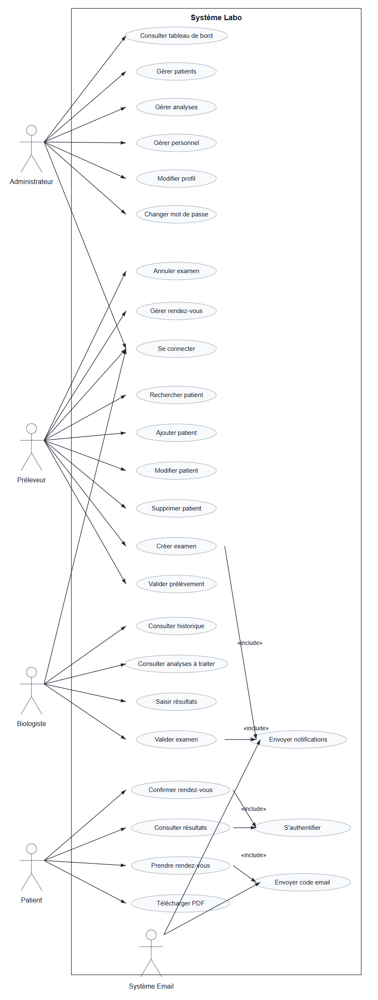

## 3.5 Diagramme de classes

Le diagramme de classes représente les entités principales :

- `Laboratoire`
- `User`
- `Patient`
- `Medecin`
- `TypeAnalyse`
- `Analyse`
- `Examen`
- `LigneExamen`
- `Resultat`
- `RendezVous`
- `Notification`
- `Historique`

### Relations principales

- Un laboratoire possède plusieurs utilisateurs.
- Un utilisateur appartient à un laboratoire.
- Un patient peut avoir plusieurs examens.
- Un médecin peut être associé à plusieurs examens.
- Un type d’analyse possède plusieurs analyses.
- Un examen appartient à un patient, à un utilisateur créateur, éventuellement à un biologiste et à un type d’analyse.
- Un examen possède plusieurs lignes d’examen.
- Une ligne d’examen appartient à une analyse.
- Une ligne d’examen peut avoir un résultat.
- Un examen peut avoir plusieurs notifications liées au suivi du dossier.

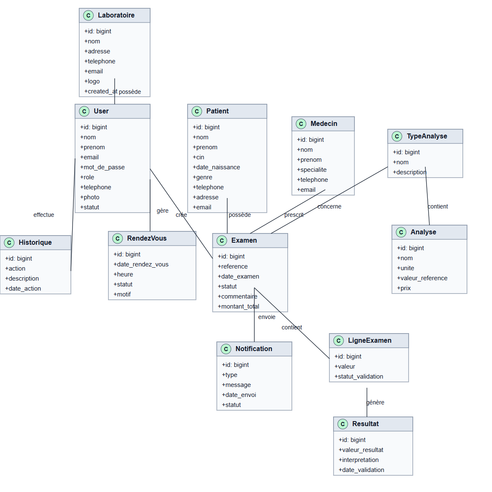

## 3.6 Diagrammes de séquence

### 3.6.1 Authentification du personnel

Éléments du diagramme :

- Acteur : utilisateur interne
- Interface React : page Login
- API Laravel : `AuthController@login`
- Modèle : `User`
- Service : Laravel Sanctum

Déroulement :

1. L’utilisateur saisit son e-mail et son mot de passe.
2. React envoie une requête POST `/api/login`.
3. Laravel valide les champs.
4. Laravel recherche l’utilisateur par e-mail.
5. Le mot de passe est vérifié avec Hash.
6. Sanctum génère un token.
7. React stocke le token et redirige selon le rôle.

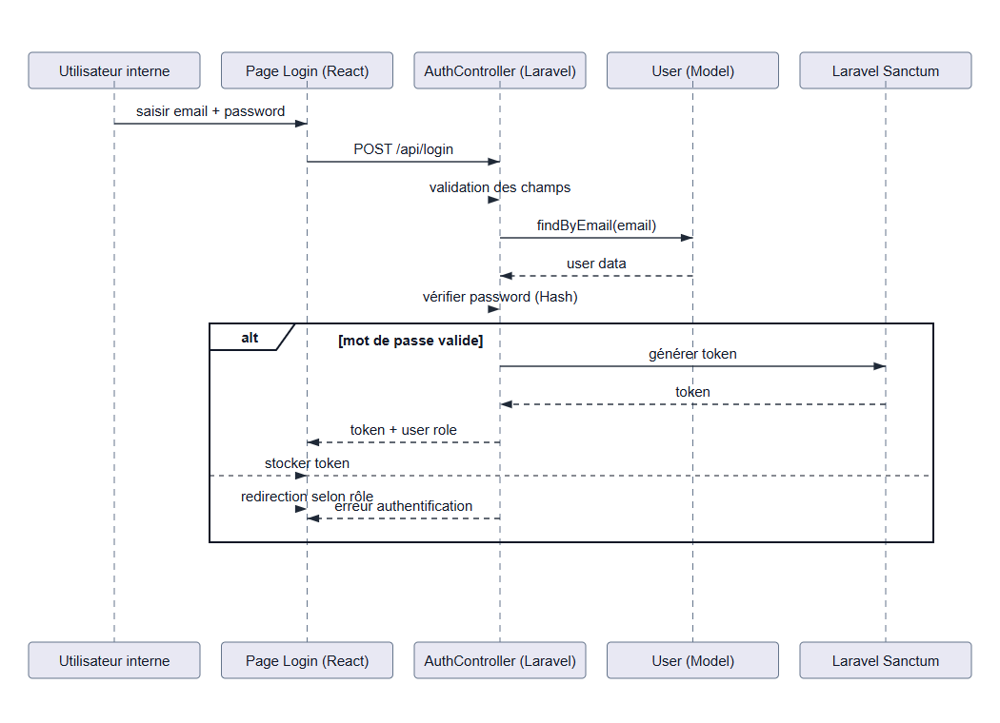

### 3.6.2 Création d’un examen

Éléments du diagramme :

- Préleveur
- Dashboard préleveur
- API `/api/examens`
- `ExamenController`
- Modèles `Patient`, `Examen`, `Analyse`, `LigneExamen`

Déroulement :

1. Le préleveur choisit un patient et un type d’analyse.
2. React envoie une requête POST `/api/examens`.
3. Laravel valide `patient_id` et `type_analyse_id`.
4. Un examen est créé.
5. Les analyses liées au type choisi sont récupérées.
6. Les lignes d’examen sont créées automatiquement.
7. La référence est retournée au frontend.

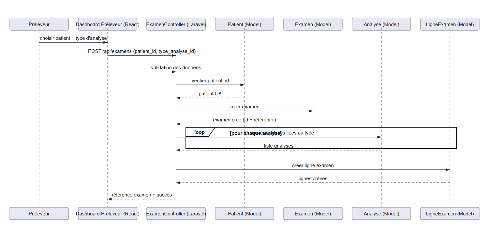

### 3.6.3 Saisie et validation des résultats

Éléments du diagramme :

- Biologiste
- Dashboard biologiste
- API `/api/examens/{id}/resultats`
- API `/api/examens/{id}/approve`
- `ExamenController`
- `LigneExamen`
- Service e-mail

Déroulement :

1. Le biologiste consulte les examens validés.
2. Il saisit les valeurs de résultats.
3. React envoie les lignes à l’API.
4. Laravel met à jour les `ligne_examens`.
5. L’examen passe au statut `en_validation`.
6. Le biologiste approuve.
7. L’examen passe au statut `termine`.
8. Un e-mail de résultat est envoyé au patient.

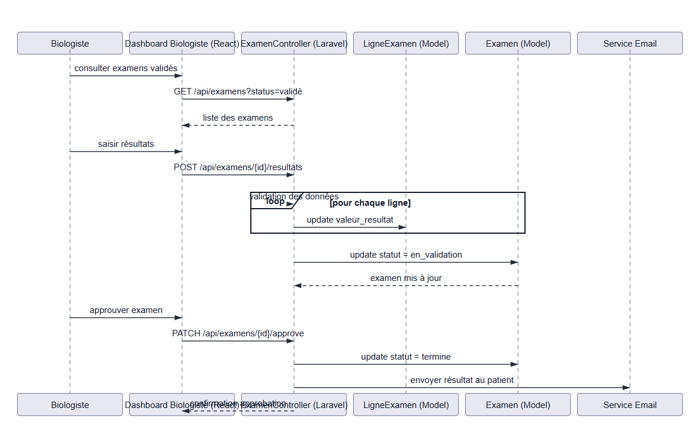

### 3.6.4 Prise de rendez-vous

Éléments du diagramme :

- Patient
- Page de rendez-vous
- API `/api/rendezvous/send-code`
- Cache Laravel
- Mail Laravel
- API `/api/rendezvous/store`

Déroulement :

1. Le patient saisit ses informations.
2. Le système envoie un code de vérification par e-mail.
3. Le code est stocké temporairement en cache.
4. Le patient saisit le code reçu.
5. Laravel compare le code.
6. Le rendez-vous est enregistré si le code est valide.

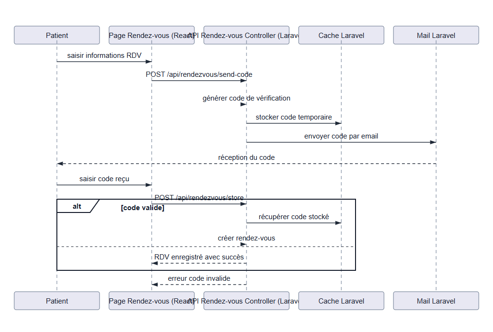

## 3.7 Analyse de la base de données

### 3.7.1 Tables principales

### Table `laboratoires`

Cette table stocke les informations du laboratoire : nom, logo, docteur responsable, adresse et identifiant administratif.

### Table `utilisateurs`

Elle représente les comptes internes : administrateur, biologiste et préleveur. Les champs principaux sont `nom_complet`, `email`, `password`, `role`, `laboratoire_id` et `avatar`.

### Table `patients`

Elle stocke les informations des patients : nom, prénom, CIN, téléphone, date de naissance, sexe, e-mail et utilisateur créateur.

### Table `medecins`

Elle contient les médecins pouvant être associés à des examens.

### Table `type_analyses`

Elle représente les catégories d’analyses, par exemple Biochimie ou Hématologie.

### Table `analyses`

Elle contient les analyses élémentaires rattachées à un type d’analyse. Chaque analyse contient une désignation, une unité de mesure et des normes.

### Table `examens`

Elle représente le dossier d’examen. Elle contient la date, le statut, la référence, le patient, le médecin, l’utilisateur créateur, le type d’analyse et le biologiste responsable.

### Table `ligne_examens`

Elle détaille les analyses élémentaires d’un examen. Elle contient la valeur du résultat, le commentaire, l’examen associé et l’analyse correspondante.

### Table `resultats`

Elle stocke la validation ou la conclusion liée à une ligne d’examen.

### Table `rendez_vous`

Elle stocke les demandes de rendez-vous : nom, prénom, téléphone, e-mail, date souhaitée, statut, CIN, sexe et date de naissance.

### Tables complémentaires

- `notifications` : messages envoyés au patient.
- `historiques` : suivi des actions sur les tables.
- `personal_access_tokens` : tokens Sanctum.
- `sessions`, `cache`, `jobs` : tables techniques Laravel.

### 3.7.2 Relations importantes

- `laboratoires` 1 → N `utilisateurs`
- `utilisateurs` 1 → N `examens`
- `patients` 1 → N `examens`
- `medecins` 1 → N `examens`
- `type_analyses` 1 → N `analyses`
- `type_analyses` 1 → N `examens`
- `examens` 1 → N `ligne_examens`
- `analyses` 1 → N `ligne_examens`
- `ligne_examens` 1 → N `resultats`
- `examens` 1 → N `notifications`

### 3.7.3 Flux de données

Le flux de données commence généralement par la création d’un patient ou d’un rendez-vous. Lorsqu’un examen est créé, il reçoit une référence unique. Le type d’analyse choisi permet de générer automatiquement les lignes d’examen. Ces lignes sont ensuite complétées par le biologiste. Après validation finale, le patient peut consulter les résultats et télécharger le PDF.

### 3.7.4 Logique métier des statuts

Les statuts jouent un rôle central :

- `en_cours` : examen créé ou rendez-vous en attente ;
- `valide` : prélèvement validé ou rendez-vous accepté ;
- `annule` : examen ou rendez-vous annulé ;
- `en_validation` : résultats saisis et en attente d’approbation ;
- `termine` : examen approuvé définitivement ;
- `rejete` : examen renvoyé pour modification.

Cette logique permet de suivre précisément l’avancement d’un dossier.

---

## 3.8 Authentification et sécurité

### 3.8.1 Authentification du personnel

Le personnel se connecte à l’aide d’un e-mail et d’un mot de passe. Le backend vérifie les informations dans `AuthController`. Si l’utilisateur existe et que le mot de passe correspond, Laravel Sanctum génère un token d’accès.

Le frontend stocke ensuite le token et les informations de l’utilisateur dans `localStorage`. La redirection dépend du rôle :

- administrateur vers `/dashboard/admin` ;
- biologiste vers `/dashboard/biologiste` ;
- préleveur vers `/dashboard/preleveur`.

### 3.8.2 Gestion des rôles

Les rôles sont définis dans la table `utilisateurs` à travers le champ `role`. Les valeurs principales sont :

- `admin`
- `biologiste`
- `preleveur`

Le frontend protège les routes grâce à `AdminRoute`, `BiologisteRoute` et `PreleveurRoute`. Si l’utilisateur n’a pas le rôle attendu, il est redirigé vers la page de connexion.

### 3.8.3 Middleware Sanctum

Côté backend, plusieurs routes sont regroupées dans :

```php
Route::middleware('auth:sanctum')->group(function () {
    // routes protégées
});
```

Ce middleware vérifie la validité du token avant d’autoriser l’accès aux ressources sensibles.

### 3.8.4 Authentification patient

Le patient n’utilise pas un compte complet comme le personnel. Il accède à ses résultats à partir :

- de la référence de l’examen ;
- de son numéro de téléphone.

Cette méthode permet un accès simplifié, mais limité aux résultats du dossier correspondant.

### 3.8.5 Vérification par e-mail

Pour la prise de rendez-vous, un code à quatre chiffres est généré et envoyé par e-mail. Ce code est conservé dans le cache pendant dix minutes. Le rendez-vous n’est enregistré définitivement que si le code saisi est correct.

### 3.8.6 Validation des données

Laravel valide les données reçues dans les contrôleurs : champs obligatoires, formats e-mail, existence des clés étrangères, valeurs de statut autorisées, etc. Cette validation limite les erreurs et renforce la robustesse du système.

### 3.8.7 Améliorations de sécurité possibles

Pour une version production, il serait pertinent d’ajouter :

- expiration stricte des tokens ;
- stockage plus sécurisé côté frontend ;
- journalisation détaillée des actions sensibles ;
- permissions backend plus fines selon les rôles ;
- protection CSRF adaptée au mode d’authentification ;
- politique de mots de passe plus stricte.

---

# CHAPITRE 4 — Réalisation et implémentation

## 4.1 Structure frontend

Le frontend est organisé autour du dossier `src`. Les fichiers principaux sont :

- `App.jsx` : déclaration des routes et protections par rôle ;
- `main.jsx` : point d’entrée React ;
- `contexts/AuthContext.jsx` : gestion de l’état d’authentification ;
- `lib/api.js` : fonctions API génériques ;
- `pages/Login.jsx` : connexion personnel/patient ;
- `pages/DashboardAdmin.jsx` : tableau de bord administrateur ;
- `pages/DashboardPreleveur.jsx` : espace préleveur ;
- `pages/DashboardBiologiste.jsx` : espace biologiste ;
- `pages/PrendreRendezVous.jsx` : formulaire de rendez-vous ;
- `pages/MesResultats.jsx` : consultation des résultats patient ;
- `components/ui` : composants UI réutilisables.

## 4.2 Implémentation du tableau de bord administrateur

Le tableau de bord administrateur affiche une synthèse de l’activité du laboratoire. Il récupère les statistiques via l’endpoint `/api/admin/stats`. Les données sont affichées sous forme de cartes et de graphiques avec Recharts.

Les fonctionnalités principales sont :

- consultation des statistiques ;
- gestion des patients ;
- gestion des analyses ;
- gestion du personnel ;
- accès au profil administrateur.

## 4.3 Implémentation de l’espace préleveur

L’espace préleveur est centré sur l’accueil et la préparation des examens. Il permet de rechercher les patients, d’ajouter ou modifier un patient, de créer un nouvel examen et de gérer les analyses du jour.

Lorsqu’un nouvel examen est créé, le frontend envoie `patient_id` et `type_analyse_id` au backend. Le backend crée l’examen et génère les lignes associées au type d’analyse.

## 4.4 Implémentation de l’espace biologiste

Le fichier `DashboardBiologiste.jsx` gère les fonctionnalités du biologiste. L’interface comporte trois onglets :

- **Mes Analyses** : examens prêts à être traités ;
- **Validation** : examens avec résultats saisis en attente d’approbation ;
- **Historique** : examens terminés.

Le biologiste peut saisir les valeurs de chaque analyse, ajouter un commentaire et identifier les valeurs anormales en les comparant aux normes. Après la saisie, l’examen passe au statut `en_validation`. Lors de l’approbation finale, l’examen passe au statut `termine`.

## 4.5 Implémentation de la prise de rendez-vous

La page `PrendreRendezVous.jsx` permet au patient de remplir un formulaire avec ses informations personnelles et la date souhaitée. Le système envoie ensuite un code de vérification par e-mail. Après validation du code, le rendez-vous est enregistré.

Ce processus améliore la fiabilité des informations saisies et réduit les demandes non confirmées.

## 4.6 Implémentation de la consultation des résultats

La page de connexion propose un onglet patient. Le patient saisit sa référence d’examen et son numéro de téléphone. Si les informations correspondent, l’examen est stocké temporairement côté frontend et le patient est redirigé vers ses résultats.

La page `MesResultats.jsx` permet également de télécharger le PDF du rapport.

## 4.7 Implémentation backend

Les contrôleurs principaux sont :

- `AuthController` : connexion, déconnexion, profil ;
- `PatientController` : gestion des patients ;
- `ExamenController` : gestion des examens, résultats, validation et PDF ;
- `RendezVousController` : gestion des rendez-vous et codes de vérification ;
- `DashboardController` : statistiques administrateur ;
- `StaffController` : gestion du personnel ;
- `AnalyseController` : gestion des analyses ;
- `BiologisteController` : statistiques biologiste ;
- `MedecinController` : gestion des médecins.

## 4.8 Communication API

La communication entre React et Laravel se fait par HTTP. Les données sont échangées au format JSON. Les requêtes protégées contiennent le token dans l’en-tête Authorization.

Exemples d’API importantes :

| Méthode | Route | Rôle |
|---|---|---|
| POST | `/api/login` | Connexion personnel |
| POST | `/api/patient/auth` | Accès résultats patient |
| GET | `/api/admin/stats` | Statistiques admin |
| GET/POST | `/api/patients` | Gestion patients |
| POST | `/api/examens` | Création examen |
| POST | `/api/examens/{id}/resultats` | Saisie résultats |
| PATCH | `/api/examens/{id}/approve` | Approbation finale |
| GET | `/api/examens/{id}/pdf` | Génération PDF |
| POST | `/api/rendezvous/send-code` | Envoi code |
| POST | `/api/rendezvous/store` | Création rendez-vous |

## 4.9 Explication des interfaces

Les interfaces du projet utilisent une identité visuelle cohérente : police Inter, couleurs bleu/slate, cartes blanches, bordures légères, tableaux structurés et sidebars colorées selon le rôle. L’administrateur utilise un thème bleu foncé, le biologiste un thème vert, et le préleveur un thème indigo.

---

## 4.10 Présentation des interfaces

### 4.10.1 Captures d’écran du projet

1. **Interface de connexion**  
   Légende : *Figure 10 : Interface de connexion Helix Lab*  
   Cette figure présente l’écran d’accès principal. Elle distingue l’accès du personnel et l’accès patient. Elle illustre également l’identité visuelle du projet.

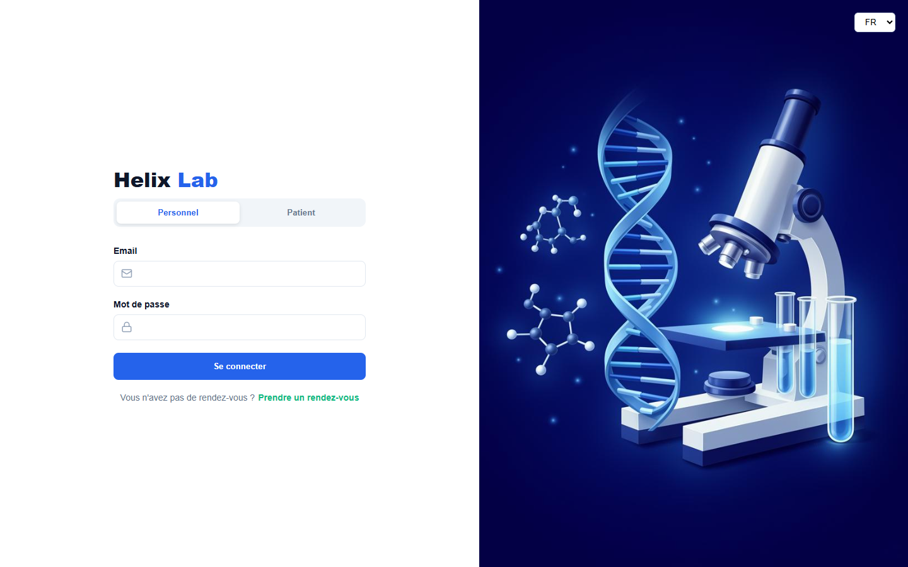

2. **Formulaire de prise de rendez-vous**  
   Légende : *Figure 11 : Formulaire de demande de rendez-vous*  
   Cette interface permet au patient de saisir ses informations et de lancer la vérification par e-mail.

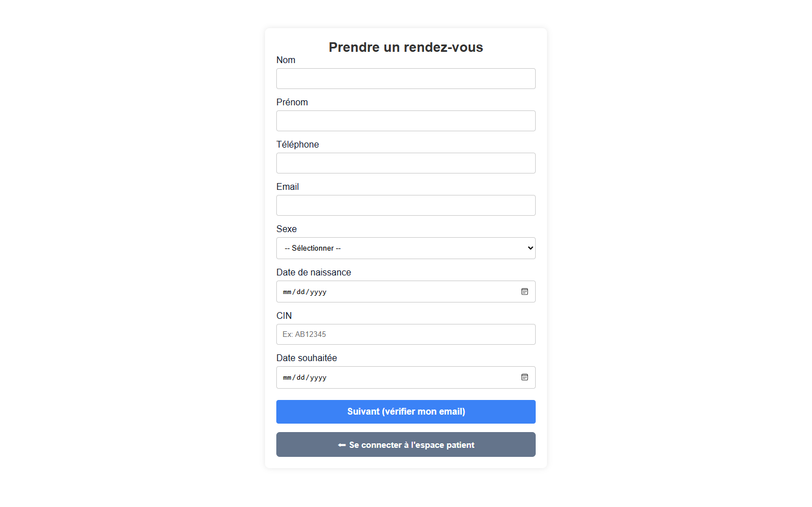

3. **Étape de vérification du code**  
   Légende : *Figure 12 : Vérification du code envoyé par e-mail*  
   Elle montre le mécanisme de confirmation du rendez-vous.

4. **Tableau de bord administrateur**  
   Légende : *Figure 13 : Tableau de bord administrateur*  
   Cette capture affiche les statistiques globales, les cartes de synthèse et les graphiques.

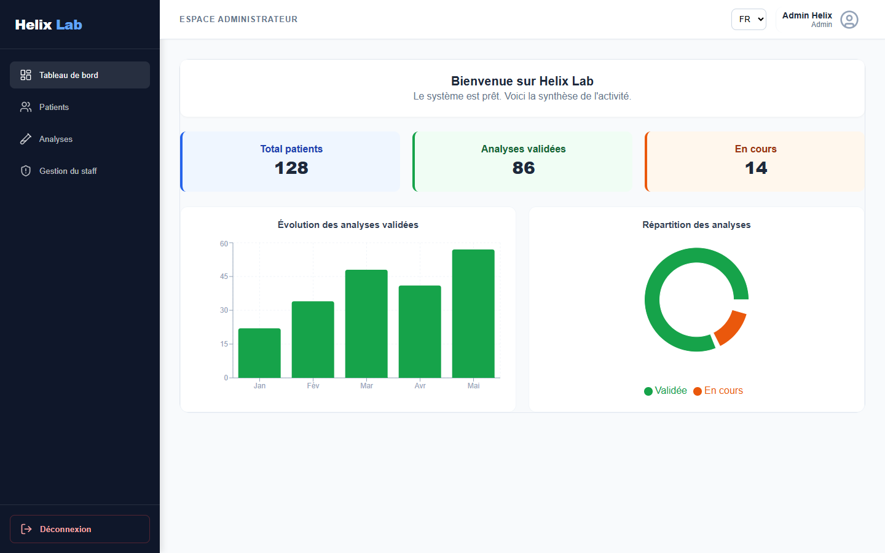

5. **Gestion des patients**  
   Légende : *Figure 14 : Liste et gestion des patients*  
   Elle montre la recherche, l’ajout, la modification et la suppression de patients.

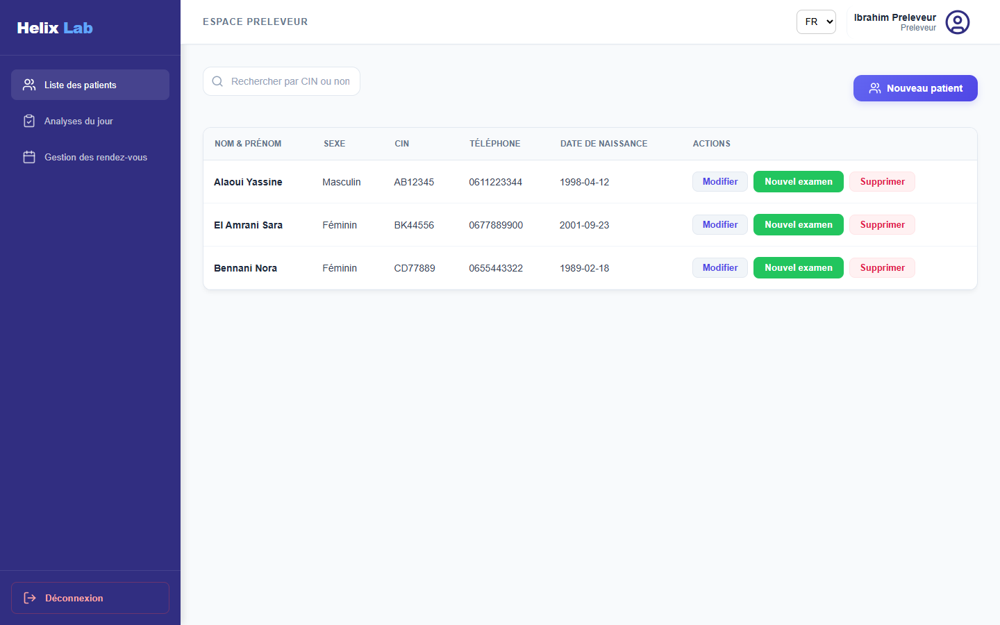

6. **Gestion des analyses**  
   Légende : *Figure 15 : Gestion des types d’analyses et analyses*  
   Elle illustre l’organisation des analyses utilisées pour générer les examens.

7. **Gestion du personnel**  
   Légende : *Figure 16 : Gestion des membres du personnel*  
   Elle montre la création et la suppression des comptes biologiste/préleveur.

8. **Espace préleveur**  
   Légende : *Figure 17 : Espace préleveur — gestion des patients*  
   Cette interface illustre le travail du préleveur dans la phase d’accueil.

9. **Modal de création d’examen**  
   Légende : *Figure 18 : Création d’un nouvel examen*  
   Elle montre l’association d’un patient à un type d’analyse.

10. **Analyses du jour**  
    Légende : *Figure 19 : Suivi des analyses du jour*  
    Cette interface permet au préleveur de valider ou annuler un prélèvement.

11. **Gestion des rendez-vous**  
    Légende : *Figure 20 : Gestion des rendez-vous par le personnel*  
    Elle montre la validation, l’annulation et le passage au laboratoire.

12. **Espace biologiste**  
    Légende : *Figure 21 : Tableau de bord biologiste*  
    Cette capture présente les examens disponibles pour traitement.

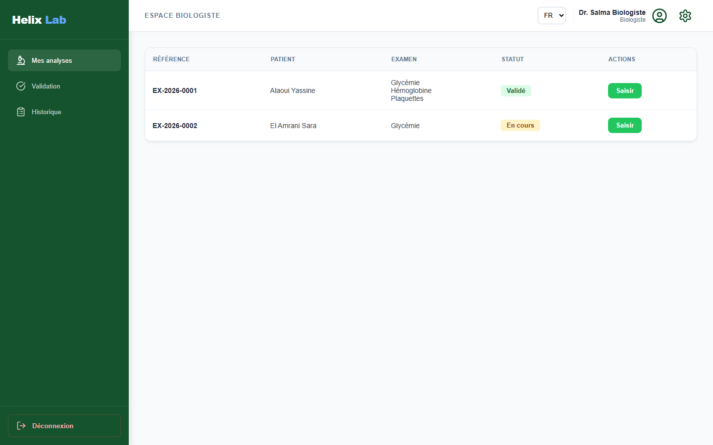

13. **Saisie des résultats**  
    Légende : *Figure 22 : Modal de saisie des résultats biologiques*  
    Elle montre les valeurs, unités, normes et commentaires.

14. **Validation finale**  
    Légende : *Figure 23 : Validation finale des résultats*  
    Elle illustre l’étape d’approbation ou de rejet.

15. **Historique biologiste**  
    Légende : *Figure 24 : Historique des examens terminés*  
    Elle montre la traçabilité des résultats validés.

16. **Consultation patient**  
    Légende : *Figure 25 : Consultation des résultats par le patient*  
    Elle présente l’espace de consultation après authentification par référence.

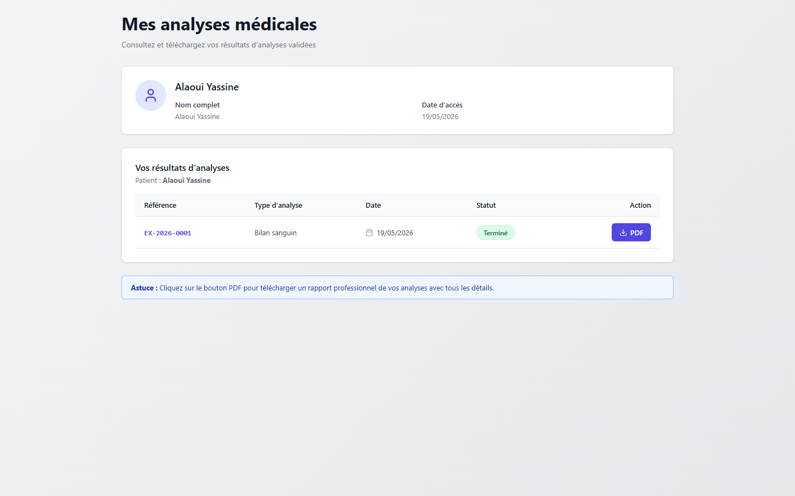

17. **Rapport PDF**  
    Légende : *Figure 26 : Rapport PDF des résultats*  
    Cette figure montre le document final généré pour le patient.

---

# CHAPITRE 5 — Tests et validation

## 5.1 Types de tests réalisés

Les tests permettent de vérifier la conformité du système aux besoins. Pour Helix Lab, plusieurs niveaux de tests sont pertinents :

- tests fonctionnels ;
- tests d’authentification ;
- tests d’autorisation par rôle ;
- tests d’API ;
- tests d’interface ;
- tests de validation des formulaires ;
- tests de génération PDF ;
- tests de consultation patient.

## 5.2 Scénarios de test fonctionnels

| N° | Scénario | Données | Résultat attendu |
|---|---|---|---|
| 1 | Connexion administrateur | E-mail et mot de passe valides | Redirection vers dashboard admin |
| 2 | Connexion invalide | Mot de passe erroné | Message d’erreur |
| 3 | Accès route biologiste par admin | Token admin | Redirection vers login |
| 4 | Création patient | Données complètes | Patient enregistré |
| 5 | Création examen | Patient + type analyse | Examen et lignes créés |
| 6 | Validation prélèvement | Examen en cours | Statut devient valide |
| 7 | Saisie résultats | Valeurs biologiques | Statut devient en_validation |
| 8 | Approbation finale | Examen en validation | Statut devient termine |
| 9 | Rendez-vous avec code correct | Code valide | Rendez-vous enregistré |
| 10 | Rendez-vous avec code incorrect | Code faux | Message d’erreur |
| 11 | Accès patient par référence | Référence + téléphone corrects | Résultats affichés |
| 12 | Téléchargement PDF | Examen existant | PDF généré |

## 5.3 Tests d’API

Les tests d’API peuvent être réalisés avec Postman ou PHPUnit. Ils doivent vérifier :

- les codes HTTP ;
- les réponses JSON ;
- la validation des champs ;
- la présence ou absence du token ;
- les droits d’accès selon le rôle ;
- la cohérence des données créées.

## 5.4 Tests d’interface

Les tests d’interface permettent de vérifier :

- l’affichage correct des tableaux ;
- la navigation entre les onglets ;
- les formulaires modaux ;
- les messages toast ;
- la responsivité ;
- la cohérence des couleurs et composants.

## 5.5 Validation finale

La validation finale consiste à exécuter un scénario complet :

1. créer un patient ;
2. créer un examen ;
3. valider le prélèvement ;
4. saisir les résultats ;
5. approuver l’examen ;
6. accéder aux résultats côté patient ;
7. générer le PDF.

Ce scénario confirme que les principaux modules communiquent correctement entre eux.

---

# Conclusion générale

Le projet Helix Lab a permis de concevoir et réaliser une application web complète pour la gestion d’un laboratoire d’analyses médicales. La solution couvre les principales étapes du processus métier : rendez-vous, gestion des patients, création des examens, validation des prélèvements, saisie des résultats, approbation biologique et consultation par le patient.

Les objectifs fixés au début du projet ont été atteints dans leur majorité. L’application propose des espaces distincts selon les rôles, une authentification sécurisée du personnel, une communication API entre React et Laravel, une base de données relationnelle structurée, des notifications par e-mail et la génération de rapports PDF.

Sur le plan technique, ce projet a permis de renforcer plusieurs compétences : développement frontend avec React, création d’API REST avec Laravel, utilisation de Sanctum, modélisation de base de données, gestion des relations Eloquent, validation des formulaires, intégration de graphiques, internationalisation et amélioration de l’expérience utilisateur.

Des difficultés ont été rencontrées, notamment dans la coordination entre les statuts des examens, la synchronisation frontend/backend, la gestion des rôles et la génération automatique des lignes d’analyse. Ces difficultés ont permis d’améliorer la compréhension du cycle de développement logiciel et de l’importance d’une bonne conception.

Pour les perspectives d’amélioration, plusieurs pistes peuvent être envisagées :

- renforcer la sécurité par des permissions backend plus précises ;
- ajouter un journal d’audit détaillé ;
- intégrer des notifications SMS ou WhatsApp ;
- ajouter un module de statistiques avancées ;
- permettre l’export Excel ;
- intégrer une signature électronique du biologiste ;
- déployer l’application sur un serveur cloud ;
- ajouter des tests automatisés plus complets ;
- connecter le système à des standards médicaux comme HL7 ou FHIR.

En conclusion, Helix Lab constitue une solution pertinente et évolutive pour accompagner la transformation numérique d’un laboratoire médical. Le projet démontre la capacité à analyser un besoin réel, concevoir une architecture logicielle cohérente et réaliser une application professionnelle répondant à des exigences fonctionnelles et techniques concrètes.

---

# Bibliographie

1. Laravel Documentation, *Laravel Framework Documentation*, https://laravel.com/docs  
2. Laravel Sanctum Documentation, *API Token Authentication*, https://laravel.com/docs/sanctum  
3. React Documentation, *React JavaScript Library*, https://react.dev  
4. Vite Documentation, *Next Generation Frontend Tooling*, https://vite.dev  
5. React Router Documentation, *Declarative Routing for React*, https://reactrouter.com  
6. Tailwind CSS Documentation, *Utility-First CSS Framework*, https://tailwindcss.com/docs  
7. Radix UI Documentation, *Accessible UI Components*, https://www.radix-ui.com  
8. shadcn/ui Documentation, *Reusable Component System*, https://ui.shadcn.com  
9. Axios Documentation, *Promise based HTTP client*, https://axios-http.com  
10. Recharts Documentation, *Composable Charting Library*, https://recharts.org  
11. i18next Documentation, *Internationalization Framework*, https://www.i18next.com  
12. DomPDF Laravel Package, *barryvdh/laravel-dompdf*, https://github.com/barryvdh/laravel-dompdf  
13. OWASP Foundation, *Web Application Security Guidelines*, https://owasp.org  
14. Booch G., Rumbaugh J., Jacobson I., *The Unified Modeling Language User Guide*, Addison-Wesley.  
15. Sommerville I., *Software Engineering*, Pearson Education.

---

# Annexes

## Annexe A — Liste des routes API

Cette annexe regroupe les principales routes du fichier `routes/api.php`, avec la méthode HTTP, l’URL, le contrôleur concerné, le rôle autorisé et la description fonctionnelle.

## Annexe B — Extraits de code importants

Les extraits de code les plus importants concernent :

- `AuthController@login`
- `AuthContext.jsx`
- `App.jsx` pour les routes protégées
- `ExamenController@store`
- `ExamenController@storeResults`
- `RendezVousController@sendVerificationCode`
- `RendezVousController@store`

## Annexe C — Modèle de base de données

Cette annexe présente le schéma relationnel de la base de données ainsi que les migrations principales utilisées pour créer les tables métier.

## Annexe D — Captures supplémentaires

Cette annexe regroupe les interfaces complémentaires non détaillées dans le corps du rapport : profil, paramètres, messages d’erreur, notifications et aperçu du rapport PDF.

## Annexe E — Guide d’installation

L’installation locale du projet peut être réalisée avec les commandes suivantes :

```bash
composer install
php artisan key:generate
php artisan migrate --seed
npm install
npm run dev
```
